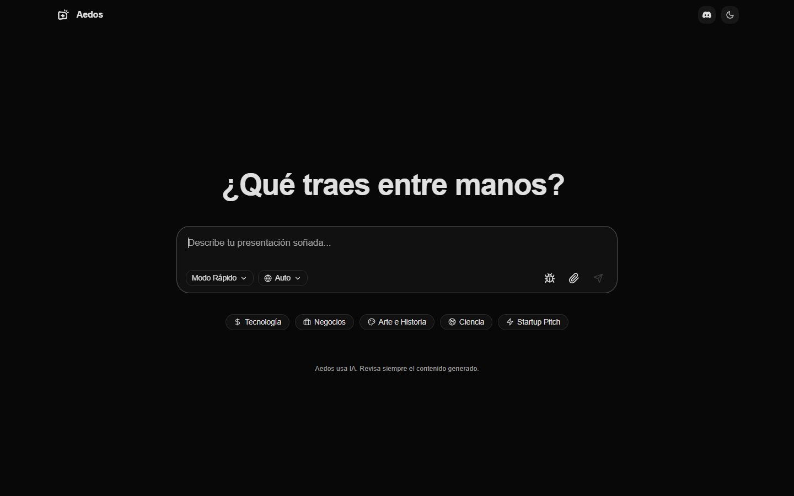
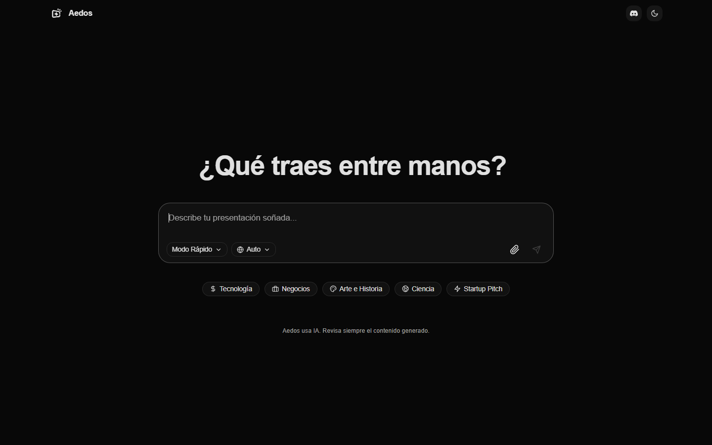
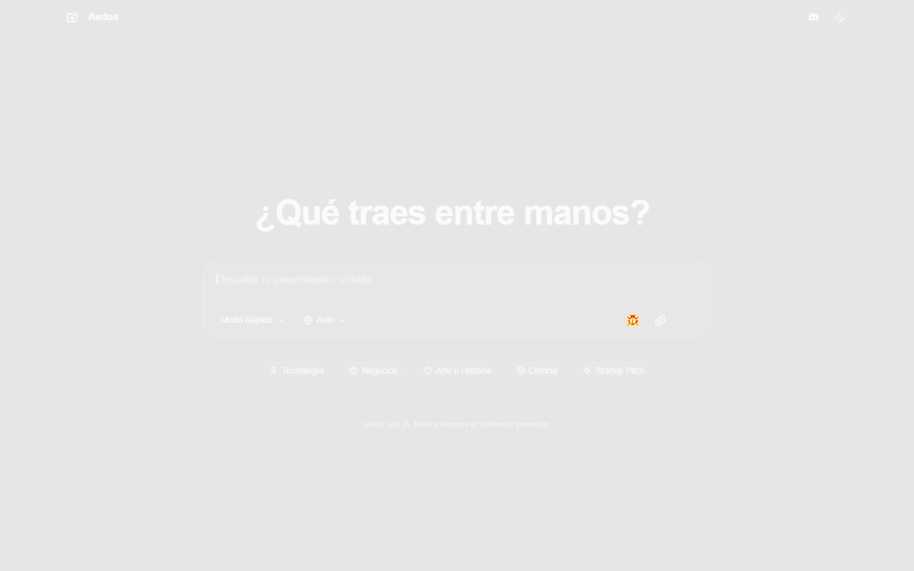

# Visual baseline diagnosis

Reproduction used the temporary `aedos-visual-diagnosis` worktree from
`refactor/fase-3c-fix`; changes were limited to that temporary checkout.

## `body` background mutation

`body { background-color: var(--bg) }` was temporarily changed to
`background-color: red`. Chrome's `getComputedStyle(body).backgroundColor`
returned `rgb(255, 0, 0)`. However, `#chat-screen` had rectangle
`(0,0,1440,900)` and opaque background `rgb(8, 8, 8)`, covering the captured
viewport. The `body` mutation changes no visible pixel and should pass.

## Meaning of the 80 differences

Reproduction against the old baseline measured `80/80/0/0` pixels at
threshold `0.1`. The diff locates them in rectangle
`x=989..1004, y=496..512` (16×17 px), not across the background.
The saved baseline contained local button `#btn-debug-last-generated`,
while `HEAD /__dev__/last-generated` returned 404 in the clean worktree and
the current capture omitted it. The count was noise from a development fixture
depending on `tmp/last-generated.html`, not detection of the red background.
`visual-config.json` contained no masks.

The complementary B.4 check changes the `#chat-screen` background, which
is painted in the viewport. That mutation creates a large difference and must
fail. The red `body` background covered by `#chat-screen` is marked as
an invisible case expected to pass.
